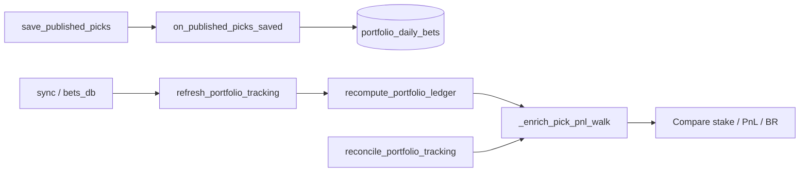

# Suivi portfolio Top5 / 1D1P — ledger journalier

Depuis **juillet 2026**, le suivi **théorique** CourtAlpha (**Top picks du jour** + 1 Day 1 Pick) repose sur un **ledger SQLite reconstructible**, distinct des paris réels `user_bets`.

> Voir aussi : [[PUBLISHED_PICKS_REPLAY]] · [[ONE_DAY_ONE_PICK]] · [[TELEGRAM_TOP5]] · [[CHANGELOG_RECENT]]

---

## 1. Objectif

| Besoin | Solution |
|--------|----------|
| Repartir à une date / bankroll données | `portfolio_tracking_config` |
| Garder **chaque pari publié** pour reconstruire l'historique | `portfolio_daily_bets` |
| Aligner replay CourtAlpha sur ce ledger | `replay_mode: portfolio_ledger` |
| Reset compte utilisateur (Miouppy) | `reset_user_portfolio.py` |

**Prod (24/07/2026)** : suivi théorique depuis **2026-07-24** à **300 €** ; compte **miouppy** / TG `7113749284` reset à **300 €** (102 paris archivés).

---

## 2. Tables SQLite

### `portfolio_tracking_config`

| Colonne | Rôle |
|---------|------|
| `mode` | `top5` ou `1d1p` (PK) |
| `start_date` | Première date incluse (YYYY-MM-DD) |
| `bankroll_start_eur` | Bankroll théorique initiale |
| `updated_ts` | Dernière (re)init |

### `portfolio_daily_bets`

**PK** : `(calendar_date, mode, bet_rank)`

| Groupe | Colonnes |
|--------|----------|
| Identité | `pick_key`, `fav_player`, `match_name`, `player1`, `player2`, `tour`, `tournament`, `match_date`, `surface` |
| Marché / modèle | `p_model_fav`, `ev_fav_pct`, `odd_fav`, `data_reliability_score`, `segment_brier` |
| Settlement | `status`, `score_final`, `winner_resolved`, `settled_ts` |
| Kelly / PnL | `stake_frac`, `stake_eur`, `profit_eur`, `bankroll_before_eur`, `bankroll_after_eur` |
| Audit | `published_ts`, `publish_source`, `payload_json` |

**Top picks du jour** (`mode=top5`) : **N lignes / jour** — union HYB P75+P80-all complète (sans plafond 5).  
**1D1P** : 1 ligne / jour (`bet_rank` = 1).

---

## 3. Flux automatique

| Événement | Hook |
|-----------|------|
| `save_published_picks()` | `on_published_picks_saved()` → copie snapshot + recompute Kelly |
| `sync_daily_top_proba_from_results()` | `refresh_portfolio_tracking()` → statut/score + recompute |

**Kelly ledger** : fraction base `KELLY_BASE_FRAC` (0,85), Brier segment **résolu à la recompute** (pas seulement la valeur SQL figée au publish), cap 15 % liquidité/jour — même walk que la réconciliation : `live_replay_engine._enrich_pick_pnl_walk` → `replay_stake_eur`.

**Publish→ledger** : échec du hook `on_published_picks_saved` est logué (`published_picks_store`, plus de `except: pass` silencieux). Preflight cron : `verify_portfolio_tracking_runtime()`.

**Void (`Annulé`)** : P/L = 0 €, mise ledger = 0 € (pas d'impact bankroll).

---

## 4. CourtAlpha replay

Quand `portfolio_tracking_config` existe pour le mode :

1. Historique lu depuis `portfolio_daily_bets` (≥ `start_date`)
2. Courbe + summary depuis le ledger (`replay_mode: portfolio_ledger`)
3. Pick **du jour** : merge settlement DB (`attach_pick_settlement_from_results`)
4. Réponse API : `selection.tracking_start_date`, `bankroll_start_eur` depuis la config

Sans config → comportement legacy (pool matin JSONL + Kelly re-simulé).

---

## 5. CLI ops

### Initialiser / réinitialiser le suivi théorique

```bash
py -3 scripts/init_portfolio_tracking.py \
  --start-date 2026-07-24 \
  --bankroll 300 \
  --mode both
```

| Flag | Défaut | Rôle |
|------|--------|------|
| `--start-date` | aujourd'hui Paris | Date de départ |
| `--bankroll` | 100 | BR théorique |
| `--mode` | `both` | `top5`, `1d1p` ou `both` |
| `--no-backfill` | — | Ne pas importer `daily_published_picks` existants |

### Reset utilisateur (paris réels + BR)

```bash
py -3 scripts/reset_user_portfolio.py \
  --username miouppy \
  --telegram-id 7113749284 \
  --bankroll 300 \
  --portfolio-bankroll 300 \
  --portfolio-start-date 2026-07-24
```

| Action | Détail |
|--------|--------|
| Supprime | Tous les `user_bets` web + TG de l'utilisateur |
| Archive | `data/exports/archives/user_bets_reset_{user}_{ts}.json` |
| Reset meta | `web_br_start_*`, `telegram_br_start_*`, ajustements manuels → 0 |
| Optionnel | Réinit suivi théorique si `--portfolio-bankroll` défini |

---

## 6. Fichiers code

| Fichier | Rôle |
|---------|------|
| `scripts/portfolio_tracking_store.py` | Schéma, sync, recompute Kelly, load replay |
| `scripts/init_portfolio_tracking.py` | CLI init / reset suivi théorique |
| `scripts/reset_user_portfolio.py` | CLI reset utilisateur + option portfolio |
| `scripts/live_replay_engine.py` | Sélection historique + fallback ledger |
| `scripts/published_picks_store.py` | Hook publish + marqueur `NO_PICK_KEY` |
| `scripts/bets_db.py` | Hook settlement → refresh ledger |
| `deploy/courtalpha/api/services/one_day_one_pick.py` | Replay 1D1P ledger |
| `deploy/courtalpha/api/services/top5_replay.py` | Replay Top5 ledger |
| `scripts/reconcile_portfolio_tracking.py` | Réconciliation ledger vs walk Kelly ; `--preflight`, `--heal`, gaps publication |
| `scripts/_diag_portfolio_drift.py` | Diagnostic mismatches Brier / stake / PnL (ops) |
| `tests/test_portfolio_tracking_store.py` | Hook publish, heal gaps, roundtrip ledger |

---

## 7. Requêtes utiles (prod)

```sql
SELECT * FROM portfolio_tracking_config;

SELECT calendar_date, fav_player, status, stake_eur, profit_eur, bankroll_after_eur
FROM portfolio_daily_bets
WHERE mode = '1d1p'
ORDER BY calendar_date, bet_rank;
```

---

## 8. Deploy PROD

**Recommandé** (depuis nov. 2026) : déploiement Git + crons, pas `scp` fichier par fichier.

```bash
ssh bettinghud
cd /opt/bettinghud
git pull origin main

# Si deploy/cron/* ou requirements ont changé
for f in deploy/cron/*; do
  sudo cp "$f" "/etc/cron.d/bettinghud-$(basename "$f")"
  sudo sed -i 's/\r$//' "/etc/cron.d/bettinghud-$(basename "$f")"
  sudo chmod 644 "/etc/cron.d/bettinghud-$(basename "$f")"
done
./venv/bin/pip install -r requirements.txt   # si besoin

sudo systemctl restart bettinghud-dashboard bettinghud-daemon bettinghud-telegram-bot
venv/bin/python scripts/reconcile_portfolio_tracking.py --preflight --heal --refresh
```

Runbook complet : [[DEPLOY_SERVEUR]] § 8 · incidents : [[OPS_PROD_DEPANNAGE]] § 0quinquies, 0sexies.

Voir aussi : [[PUBLISHED_PICKS_REPLAY]].

---

## 9. Réconciliation ledger vs replay Kelly

Script : `scripts/reconcile_portfolio_tracking.py`

Compare chaque ligne `portfolio_daily_bets` avec le **même walk Kelly** que le recompute : `_enrich_pick_pnl_walk` (Brier segment résolu + `replay_stake_eur`). Le summary agrégé sim utilise `summary_from_enriched_walk` — **pas** un second chemin `simulate_sequential_intraday` / `kelly_replay_metrics` hétérogène.

```bash
py -3 scripts/reconcile_portfolio_tracking.py --preflight --heal --refresh --fail-on-drift
py -3 scripts/reconcile_portfolio_tracking.py --json
```

| Flag | Rôle |
|------|------|
| `--preflight` | `verify_portfolio_tracking_runtime()` — imports publish→ledger |
| `--heal` | `heal_portfolio_ledger_gaps` — comble les jours publiés TG absents du ledger |
| `--refresh` | Settlement sync + `recompute_portfolio_ledger` (walk unifié) avant compare |
| `--tol-eur` | Tolérance P/L (défaut 0,02 €) |
| `--fail-on-drift` | Exit code 1 si écart P/L ou trou ledger (cron / CI) |

Échecs ledger à la publication : logger `published_picks_store` (niveau exception). Rapport de trous : `ledger_publication_gap_report`.

Cron prod (06:40 Paris) — `deploy/cron/reconcile-portfolio` :

```cron
40 6 * * * ubuntu cd /opt/bettinghud && /opt/bettinghud/venv/bin/python scripts/cron_run_with_alert.py --job "Portfolio reconcile 06:40" --log data/logs/reconcile_portfolio.log --dedup-key portfolio_reconcile_drift -- /opt/bettinghud/venv/bin/python scripts/reconcile_portfolio_tracking.py --preflight --heal --refresh --fail-on-drift
```

Historique incident **08/11/2026** : dérive massive corrigée par alignement walk (`f457367`) + verrou publish→ledger (`05512a5`). Runbook : [[OPS_PROD_DEPANNAGE]] § 0sexies.

---

## 10. Architecture Kelly (référence rapide)



- **Colonne audit** `segment_brier` : snapshot au publish (trace) ; **mises** recalculées via résolution segment + bundle actuel au recompute.
- **Void** : stake et P/L ledger à 0 (inchangé).

---

## 11. Dépannage dérive P/L

| Étape | Commande |
|-------|----------|
| Preflight + heal + refresh | `reconcile_portfolio_tracking.py --preflight --heal --refresh` |
| Détail 30 picks | `_diag_portfolio_drift.py --mode top5 --limit 30` |
| JSON pour scripts | `reconcile_portfolio_tracking.py --refresh --json` |

Si mismatch persiste après `--refresh` : vérifier bundle ML (`models/`), `portfolio_tracking_config`, puis logs `data/logs/reconcile_portfolio.log` et `published_picks_store` le matin du jour manquant.
